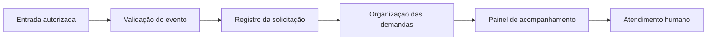

# Arquitetura de referência

O fluxo abaixo organiza a discussão do case. Não reproduz a topologia nem contratos privados.

## Decisões a avaliar

Separar o recebimento de eventos do trabalho operacional permite responder a indisponibilidades sem confundir entrega de mensagem com conclusão de atendimento. Essa separação exige estados explícitos e uma política de repetição: um evento recebido novamente não deve criar outra demanda por acidente.

O painel precisa receber apenas o contexto necessário para a função de cada operador. Uma identificação técnica de evento pode apoiar rastreabilidade; copiar o conteúdo completo da conversa para todos os logs amplia exposição desnecessariamente.

## Modos de falha e roteiro de validação

- Repetir um evento fictício e verificar que a demanda não é duplicada.
- Simular uma falha após persistência e antes da confirmação ao canal.
- Tentar consultar uma demanda com um usuário sem permissão.
- Interromper uma integração e verificar que o painel não apresenta sucesso indevido.
- Conferir que logs e mensagens de erro não revelam conteúdo de conversas.

Este é um roteiro sugerido, não uma suíte executada neste repositório. A revisão desta publicação cobre somente os documentos.
